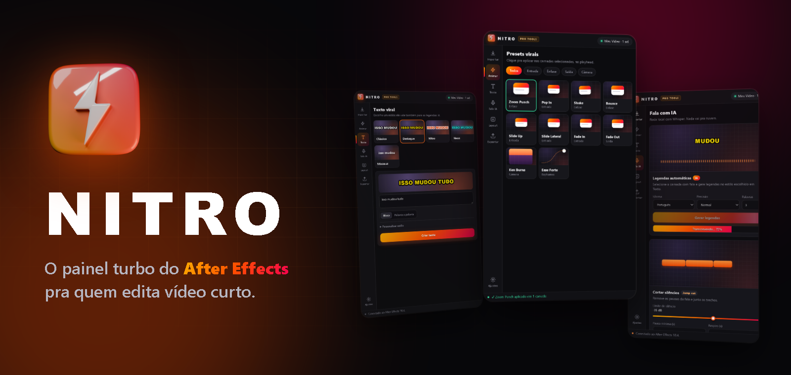
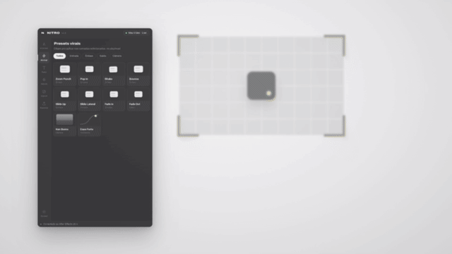
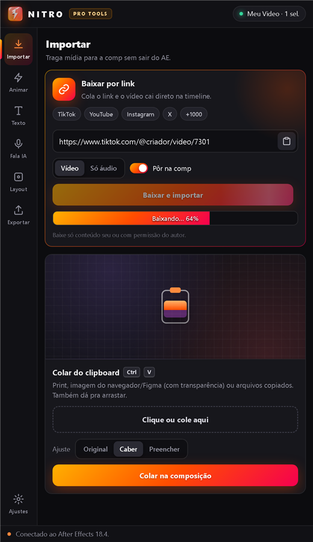
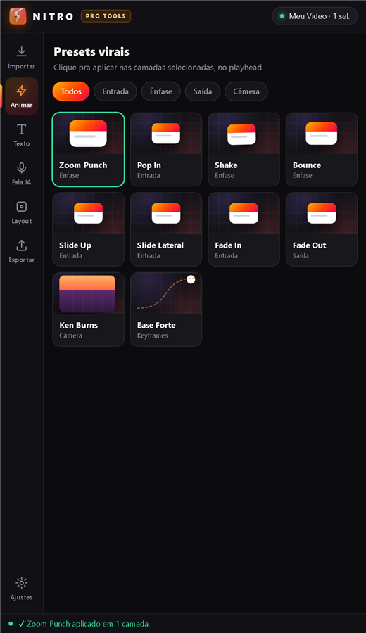
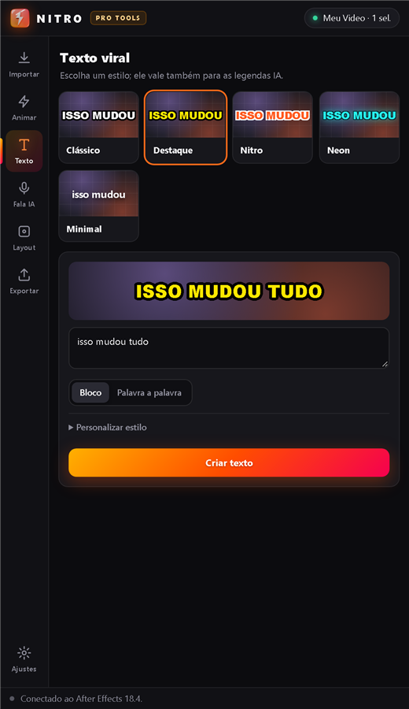
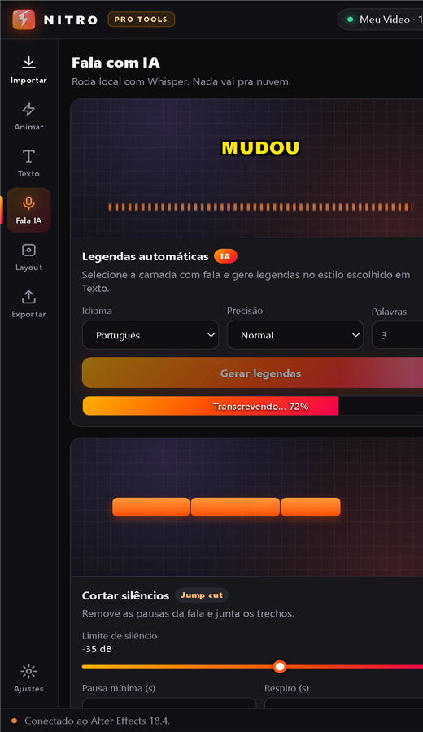
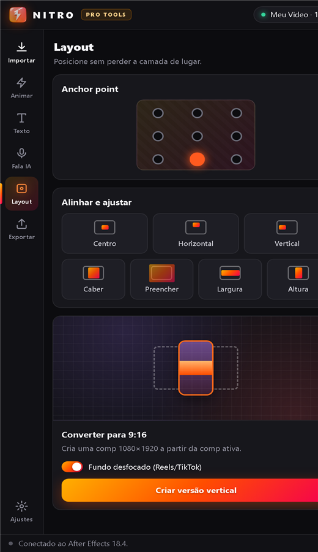
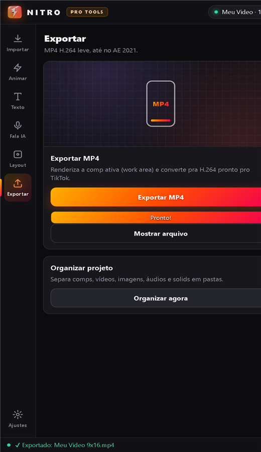
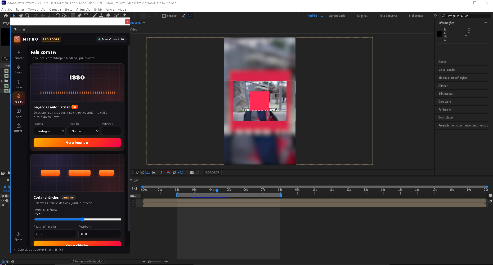

<p align="center">
  
</p>

<p align="center">
  <b>Grátis · open source · funciona no After Effects 2019 → 2025</b><br>
  <a href="../../releases/latest"><b>⬇ Baixar a última versão</b></a>
</p>

---

**Nitro** é uma extensão para o **Adobe After Effects** que junta, num painel só, o que todo editor de vídeo curto (TikTok, Reels, Shorts) faz o dia inteiro:

> cola o link → baixa o vídeo → legenda com IA → corta os silêncios → vira 9:16 → exporta MP4. **Sem sair do AE.**

<p align="center"></p>

## ⚡ O que tem dentro

| | Função | O que faz |
|---|---|---|
| ⬇ | **Baixar por link** | TikTok, YouTube, Instagram, X e +1000 sites (via yt-dlp). Já converte para H.264 compatível e joga na timeline. |
| 📋 | **Colar do clipboard** | `Ctrl+V` cola print, imagem do navegador/Figma (com transparência) ou arquivos copiados direto na comp. Também aceita arrastar e soltar. |
| ✨ | **Presets virais** | Zoom Punch, Pop In, Shake, Bounce, Slide Up/Lateral, Fade In/Out, Ken Burns e Ease Forte, com preview animado de cada um. |
| 🔤 | **Texto viral** | Estilos prontos (Clássico, Destaque, Nitro, Neon, Minimal), em bloco ou palavra a palavra, com pop animado. |
| 🎙 | **Legendas com IA** | Whisper rodando **local** (nada vai pra nuvem). Gera as legendas cronometradas no estilo escolhido. |
| ✂ | **Cortar silêncios** | Jump cut automático: remove as pausas da fala e junta os trechos. |
| ⊕ | **Anchor point** | 9 posições, sem a camada sair do lugar (funciona com escala, rotação, parent e keyframes). |
| ▣ | **Alinhar e ajustar** | Centralizar, Caber, Preencher, Largura, Altura. |
| ▯ | **Converter para 9:16** | Cria a versão vertical com fundo desfocado estilo Reels. |
| ▶ | **Exportar MP4** | H.264 leve direto do AE, **inclusive no AE 2021**, que não exporta H.264 nativo. |
| 🗂 | **Organizar projeto** | Separa comps, vídeos, imagens, áudio e solids em pastas. |

Cada ação vira **um único Ctrl+Z** no AE.

<p align="center">
  
  
  
</p>
<p align="center">
  
  
  
</p>

<p align="center"></p>

## 📦 Instalação

### Windows
1. Baixe o **`Nitro-vX.Y.Z.zip`** na [última release](../../releases/latest) e extraia.
2. Dê dois cliques em **`install\install.bat`**. Ele instala a extensão, libera extensões não assinadas e, se você tiver o `winget`, instala o **yt-dlp** e o **ffmpeg**.
3. Abra o After Effects: **Janela › Extensões › Nitro** (*Window › Extensions › Nitro*).

### macOS
```bash
chmod +x install/install.sh && ./install/install.sh
```

### Dependências
O painel mostra o status em **⚙ Ajustes**, com botão de instalar.

| Ferramenta | Para quê | Instalar |
|---|---|---|
| [yt-dlp](https://github.com/yt-dlp/yt-dlp) | Download por link | Botão no painel ou `winget install yt-dlp.yt-dlp` |
| [ffmpeg](https://ffmpeg.org) | Export MP4, cortes, legendas | `winget install Gyan.FFmpeg` / `brew install ffmpeg` |
| Python 3.9+ e [faster-whisper](https://github.com/SYSTRAN/faster-whisper) | Legendas com IA | `python -m pip install faster-whisper` |

Na primeira legenda, o modelo do Whisper (~150 MB no modo "Normal") é baixado uma vez só.

## 🎬 Fluxo típico

1. **Importar** → cole o link → **Baixar e importar**.
2. Selecione a camada → **Fala IA** → **Cortar silêncios** e depois **Gerar legendas**.
3. **Layout** → **Criar versão vertical**.
4. **Animar** → **Zoom Punch** nos momentos fortes.
5. **Exportar** → **Exportar MP4**. O arquivo vai para `Nitro Exports`, ao lado do projeto (ou em `Documentos\Nitro`).

## 🧠 Por dentro

```
CSXS/manifest.xml     CEP 9+ (AE 2019+), Node.js habilitado
client/               painel HTML/CSS/JS, sem frameworks (compatível com o Chromium 61-74 do CEP)
  js/lib.js           lógica pura (progresso, silêncios, agrupamento de legendas)
  js/tools.js         Node: yt-dlp, ffmpeg, clipboard, Whisper
  js/cep.js           ponte com o ExtendScript (sem dependência da Adobe)
host/nitro.jsx        ExtendScript: tudo que mexe no projeto do AE (ES3)
scripts/              clipboard.ps1 (Windows) e captions.py (faster-whisper)
```

O export renderiza a comp com o template **Lossless/Sem perdas** do AE e converte com ffmpeg para H.264 (CRF 18, `+faststart`). O arquivo intermediário fica em `%APPDATA%\Nitro\tmp` e é apagado no final. Ele ocupa uns 190 MB por segundo em 1080×1920, então deixe alguns GB livres para vídeos longos.

O Nitro **não precisa** ativar "Permitir que scripts gravem arquivos": quem grava arquivos é o Node do painel.

## 🧪 Testes

```bash
npm test               # lógica pura + integração com ffmpeg/clipboard
npm run test:host      # 50 testes dentro do After Effects (abra o painel Nitro e um projeto vazio)
```

Os testes do host rodam pelo painel aberto (porta de debug do arquivo `.debug`): anchor point com escala/rotação/parent/keyframes, alinhamento, fit, todos os presets, texto, importação, legendas, jump cut, 9:16, render e organização. Foram validados no **AE 2021 (18.4) em português**.

## ⚠️ Uso responsável

Baixe apenas vídeos **seus** ou com **permissão/licença** do autor. Respeite os termos das plataformas e os direitos autorais. O Nitro não hospeda nem distribui conteúdo. *(As capturas de demonstração usam "Me at the zoo", o primeiro vídeo do YouTube, apenas para ilustrar o funcionamento.)*

## 🛠 Desenvolvimento

```powershell
powershell -ExecutionPolicy Bypass -File install\install.ps1 -Dev   # junction para esta pasta
```

Feche e reabra o painel depois de editar. O DevTools do painel fica em `http://localhost:8099`.

## Licença

[MIT](LICENSE). Use, modifique e compartilhe.
